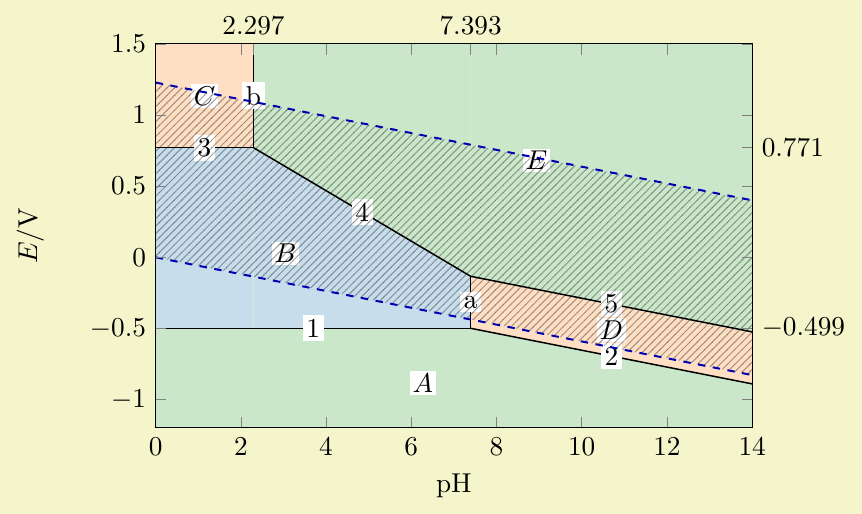
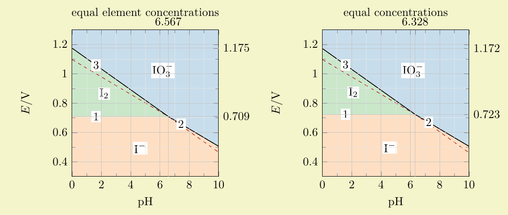
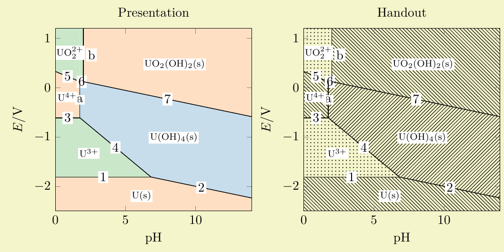

# luapourbaix

A generic PGFPlots library for limiting potential–pH (Pourbaix) diagrams,
usable with **plain LuaTeX, LuaLaTeX and ConTeXt MkIV**.

**Author and current maintainer:** Christophe Jorssen  
**Contact:** [christophe.jorssen@gmail.com](mailto:christophe.jorssen@gmail.com)  
**Repository:** <https://github.com/cjorssen/luapourbaix>  
**License:** [LPPL 1.3c or later](COPYING.md), maintenance status `maintained`.

**AI disclosure:** this package was **“vibe coded” with ChatGPT 6 Astra**, under
Christophe Jorssen's direction. Christophe Jorssen is the author and maintainer.
See [AUTHORS.md](AUTHORS.md). This disclosure is not a scientific validation of
the thermodynamic data.

Version **1.0** (2026-10-08).

[Download the manual](https://github.com/cjorssen/luapourbaix/releases/download/v1.0/luapourbaix-manual.pdf)
· [Release and source archive](https://github.com/cjorssen/luapourbaix/releases/tag/v1.0)

## Replaces the unsupported pourbaix package

The earlier [pourbaix package](https://github.com/cjorssen/pourbaix) is no longer
maintained or supported. **Use luapourbaix for new work and migrate existing
documents to the interface documented in this manual.** The original pourbaix
was published only on GitHub and was **never distributed through CTAN**.

This is a replacement implementation, not a package-name-only migration. Load
luapourbaix with `\usepgfplotslibrary{pourbaix}` after PGFPlots: the library name
`pourbaix`, its key family and its axis environment belong to luapourbaix and do
not refer to the unsupported `\usepackage{pourbaix}` package.

## What it does

Declare an element, species, thermodynamic data, temperature, total element
concentration and an explicit aqueous boundary convention. The library checks
and completes the data, calculates candidate boundaries, then selects the
limiting existence/predominance domains, including disproportionation.

Draw final diagrams, optional diagnostic overlays, water stability boundaries,
TikZ classification maps and composed reports. Customize domain colors, opacity,
patterns, labels, boundary styles and characteristic extra ticks through PGF keys.
Use `pourbaix/build={...}` after setting `pourbaix/pH min` and `pH max` to
run declaration, checking, calculation and finalization in one action. Native
PGF `.get` queries expose the resulting constants and boundary equations.
`\pgfpourbaixset{...}` addresses the `/pgfplots/pourbaix` family directly.
Both `\addpourbaix` and `\addpourbaixwater` require a final semicolon.
The declaration option `nernst factor=0.06` selects the classroom approximation
in volts; `auto` retains the temperature-derived value. Associated water overlays
inherit it, and thermodynamic closure uses the same factor.
An offline, sourced thermodynamic catalogue supplies missing independent data.
Named domain palettes include Matplotlib/Tableau `tab10`, `tab10 light`,
`grayscale`, and TikZ `patterns`/`hatching`; `monochrome` selects black patterns.
For example, use `\addpourbaix[domain palette=monochrome]{Fe};`.
Automatic palette slots distinguish adjacent retained domains.

The manual opens with three worked tutorials: Maxime prepares an iron worksheet,
Sophie illustrates iodine disproportionation and boundary conventions, and Aya
builds a uranium diagram from her own thermodynamic data.

## Figures from the manual

Maxime's iron worksheet: lettered domains, characteristic ticks and a hatched
water stability region over the colored iron diagram.



Sophie compares boundary conventions and shows iodine disproportionation;
dashed red lines retain the provisional boundaries.



Aya uses the same uranium calculation for a color presentation and a patterned
handout. The pale background is the manual's example-box highlighting.



These are crops of figures compiled inside the manual, not separate examples.

## Installation and requirements

Runtime requirements are LuaTeX, PGF/TikZ and PGFPlots. No runtime network access,
shell escape, Python or external executable is needed. Other engines have not
been qualified merely because they support Lua.

Copy every runtime file to `tex/generic/luapourbaix/` in your personal TeX tree
and refresh its filename database if necessary. In the repository these files
already occupy that path; in the CTAN source archive they are under `tex/`.
The Lua files must stay alongside `pgflibrarypgfplots.pourbaix.code.tex`.

Load the library after PGFPlots:

```tex
\usepackage{pgfplots} % LuaLaTeX
\pgfplotsset{compat=1.18}
\usepgfplotslibrary{pourbaix}
```

For plain LuaTeX, use `\input pgfplots.tex` instead of `\usepackage`.
For ConTeXt MkIV, use `\usemodule[pgfplots]` followed by
`\usepgfplotslibrary[pourbaix]`. The declaration and drawing keys are shared.

## A complete example

```tex
\pgfplotsset{pourbaix/declare={
  name=Fe,element=Fe,temperature=298.15,concentration=.01,
  species={Fe(s),Fe^2+,Fe^3+,Fe(OH)2(s),Fe(OH)3(s)},
  boundary convention=equal element concentrations,constants={}},
  pourbaix/check=Fe,pourbaix/calculate=Fe,
  pourbaix/pH min=0,pourbaix/pH max=14,pourbaix/finalize=Fe}
\begin{tikzpicture}
\begin{axis}[pourbaix/axis,xmin=0,xmax=14,ymin=-1.2,ymax=1.5]
  \addpourbaix{Fe};
  \addpourbaixwater[prepare={diagram=Fe},domain labels=false];
\end{axis}
\end{tikzpicture}
```

Inside a TikZ picture, `\begin{pourbaix}[declare={...},check=Fe,calculate=Fe,
pH min=0,pH max=14,finalize=Fe,xmin=0,xmax=14,...]` also wraps an ordinary axis.
It reads chemical keys first and forwards other options through PGFKeys to the
axis. Generic `\pourbaix`/`\endpourbaix` and ConTeXt
`\startpourbaix`/`\stoppourbaix` forms are available; preparation stays explicit.

The empty constants list requests the offline fallback catalogue. The water
overlay assumes ideal gases with independent default partial pressures of
1 bar, unit water activity, and potentials versus SHE. The working temperature
is explicit; data are not extrapolated to other temperatures.

## Documentation and scientific scope

The [manual source](doc/luapourbaix-manual.tex) contains all examples inline.
The distributed PDF is `doc/luapourbaix-manual.pdf`; local builds write
`build/manual/luapourbaix-manual.pdf`. Its six parts cover getting started, the
user reference, scientific algorithms, worked examples, thermodynamic provenance
and technical details. Examples include Fe, Cu, Zn, Al, Ag, Pb, Ni, Cr, Mn and Cl.

This is a **limiting ideal-solution construction**, not full aqueous speciation.
Only declared species have domains. The explicit concentration convention,
solid phase and selected species set affect the result. Mixed source standard
states and highly alkaline teaching examples have documented limitations;
[the scientific audit](doc/scientific-audit.md) records verified source
transformations, the copper cycle discrepancy and remaining reference-quality
limitations. [Source notes](doc/SOURCES.md) identify the underlying compilations.

## Building and preparing distributions

Building and testing additionally need Python 3.8+, Make, MakeIndex and a TeX distribution
with all three formats and PGF's manual tools. Nothing is installed globally.

```sh
make doctor   # inspect local tools
make check    # Lua, three formats, negative tests, manual and index
make dist     # run checks and create the CTAN source archive
make clean    # remove the generated build tree only
```

Archives and their SHA-256 checksums are written under `build/dist/`. The source
archive includes handwritten runtime sources, the PDF and source manual, tests,
build scripts and license notices; it excludes caches, logs and working notes.
See [CONTRIBUTING.md](CONTRIBUTING.md) and [the release procedure](doc/releasing.md).

Copyright 2026 Christophe Jorssen. See [COPYING.md](COPYING.md),
[LICENSE](LICENSE) and [MANIFEST.md](MANIFEST.md).
